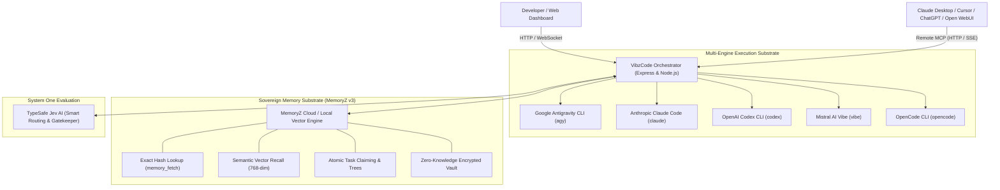
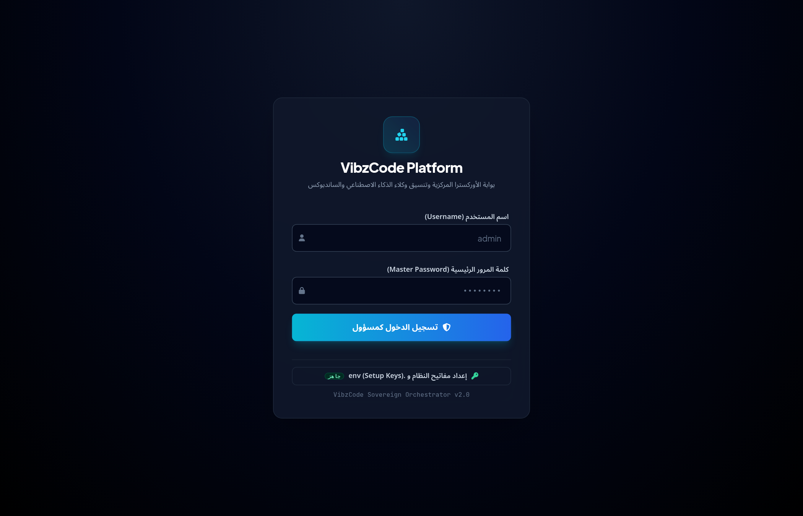
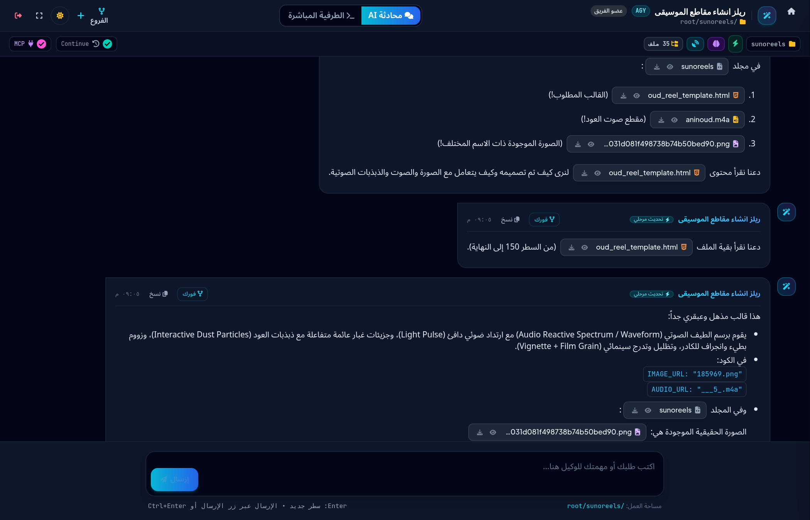

# VibzCode

[](https://www.npmjs.com/package/vibzcode)
[](https://opensource.org/licenses/MIT)
[](https://nodejs.org/)
[](https://github.com/Zizwar/vibzcode)

**VibzCode** is a sovereign, self-hosted Multi-Engine AI Agent Orchestrator and Workspace Platform. It provides a centralized command bridge to configure, isolate, dispatch, and supervise autonomous agent sessions across multiple AI CLI engines, backed by a persistent zero-knowledge memory substrate (**MemoryZ v3**) and dual-layer **Remote Model Context Protocol (MCP)** endpoints.

---

## 🌟 Architecture Overview



---

## 📸 Visual Showcase & Dashboards

| Central Sessions Dashboard (Grid View) | Hierarchical Branching & Forks (Tree View) |
| :---: | :---: |
|  |  |

| Interactive Agent Console & Media Preview | Workspace Sandbox Explorer |
| :---: | :---: |
|  |  |

> 🌐 **الصفحة التعريفية باللغة العربية:** يمكنك زيارة [الصفحة التعريفية الشاملة لمنصة VibzCode](https://zizwar.github.io/vibzcode/) للاطلاع على المميزات الكاملة ودليل الاستخدام السريع.

---

## 🚀 Key Highlights & Capabilities

### 1. Instant One-Command Boot (`npx vibzcode`)
Zero-friction bootstrapping: run `npx vibzcode` on any machine (Linux, macOS, Windows). VibzCode launches its daemon, probes environment credentials, and immediately opens the visual administration dashboard in your browser.

### 2. Multi-Engine AI Substrate
Seamlessly assign different projects or team tasks to specialized AI coding engines with custom permission boundaries:
- **Google Antigravity CLI (`agy`)**: Official Google agentic coding assistant with sandbox enforcement and directory scoping.
- **Anthropic Claude Code (`claude`)**: Deep architectural refactoring, bash automation, and terminal-native capabilities.
- **OpenAI Codex CLI (`codex`)**: Autonomous verification, unit testing, and script generation.
- **Mistral AI Vibe (`vibe`)**: Generative workspace manipulation and fast lightweight coding routines.
- **OpenCode CLI (`opencode`)**: Open-source multi-model CLI engine with automated approvals.

### 3. Shared Sovereign Memory Substrate (MemoryZ v3)
Prevent LLM context amnesia across distinct sessions and developer machines:
- **Exact Hash Retrieval (`get_memory`)**: Fetch explicit architectural rules, credentials, or documentation by deterministic cryptographic hash.
- **Memory-as-Attachment (`memory_refs`)**: Transparently inject stored memories directly into session prompts formatted as `<attached_memories_from_memoryz>`.
- **Hierarchical Tasks & Atomic Claiming**: Coordinate parallel multi-agent swarms with atomic locking (`task_claim`) to prevent duplicate agent labor.
- **Namespace Isolation**: Segregate state across projects (`default`, `vibzcode`, `enterprise`, etc.).

### 4. Dual-Plane Remote MCP Architecture
Expose your agents and workspace files to external AI frontends through standard Model Context Protocol (MCP) Streamable HTTP and SSE transports:
1. **Agent Session Plane (`/mcp?token=<SESSION_TOKEN>`)**: Scoped to a specific project directory. Provides `ask_agent`, `read_workspace_file`, `write_workspace_file`, `list_workspace_files`, `run_shell_command`, and `store_memory`.
2. **Orchestrator Master Plane (`/mcp/orchestrator?token=<ADMIN_SECRET>`)**: Provides dynamic agent provisioning (`session_create`), asynchronous task dispatching (`agent_dispatch`), multi-agent handoffs (`handoff`), and system notifications (`notify`).

### 5. Automated Setup Wizard & Key Sensing
On initial launch, VibzCode automatically probes for essential AI keys:
- If keys are missing, an interactive setup wizard guides you through entering them via a secure web dialog or generating terminal export snippets.
- Keys are written to `.env` with strict file permissions (`0o600`), and all sessions/databases are excluded from Git and npm packaging.

---

## 💻 Quick Start

### Option A: Run directly via NPX or PNPM (Recommended)
```bash
# Launch server and auto-open browser dashboard
npx vibzcode

# Or via pnpm dlx
pnpm dlx vibzcode

# Specify custom port
npx vibzcode --port 3333

# Run in headless mode (no auto-open)
npx vibzcode --no-open

# Check system keys status without starting server
npx vibzcode --status
```

### Option B: Install Globally (NPM or PNPM)
```bash
# Via npm
npm install -g vibzcode
vibzcode

# Or via pnpm
pnpm add -g vibzcode
vibzcode
```

### Option C: Run from Source
```bash
# Clone the repository
git clone https://github.com/Zizwar/vibzcode.git
cd vibzcode

# Install dependencies
npm install

# Start development server
npm start
```

### Option D: Production with PM2
```bash
pm2 start ecosystem.config.cjs
pm2 logs vibzcode
```

---

## 📦 Programmatic JavaScript / TypeScript SDK

In addition to the CLI and Web Dashboard, VibzCode can be imported directly into any Node.js / TypeScript project:

```bash
npm install vibzcode
```

### 1. Basic Agent Execution (`askAgent` / `vibzcode`)
```javascript
const { vibzcode, askAgent } = require('vibzcode');
// or: import { vibzcode, askAgent } from 'vibzcode';

async function main() {
  // Execute a coding task using Google Antigravity (agy)
  const result = await askAgent({
    engine: 'agy',                  // 'agy' | 'claude' | 'codex' | 'vibe' | 'opencode'
    prompt: 'Implement a rate limiter middleware for Express in TypeScript',
    targetDir: './src',             // Working directory for code edits
    sandbox: true,                  // Enforce workspace sandbox
    autoApprove: true               // Automatically approve non-destructive edits
  });

  console.log('Agent Response:\n', result.response);
  console.log(`Executed in ${result.duration}s via ${result.engine}`);
}

main();
```

### 2. Multi-Engine Routing & Switching
```javascript
const { vibzcode } = require('vibzcode');

// Shorthand syntax: vibzcode(engine, prompt, options)
// 1. Using Claude Code for architectural review
const review = await vibzcode('claude', 'Review architecture of database models in models/', {
  targetDir: process.cwd()
});

// 2. Using OpenAI Codex for unit testing
const tests = await vibzcode('codex', 'Generate unit tests for authService.js');

// 3. Using Mistral Vibe for quick script manipulation
const script = await vibzcode('vibe', 'Create a migration script from CSV to SQLite');
```

### 3. Shared MemoryZ Integration & Context Injection
VibzCode integrates natively with **MemoryZ v3**. You can pass credentials explicitly, supply a full URI with embedded token, or attach historical memory hashes:

```javascript
const { vibzcode } = require('vibzcode');

async function runWithMemory() {
  const result = await vibzcode({
    engine: 'agy',
    prompt: 'Refactor payment gateway to support Cryptomus webhook signatures',
    targetDir: './payments-service',

    // MemoryZ Configuration:
    // Option A: Explicit url & token
    memoryz: {
      url: 'https://memoryz.wino.deno.net',
      token: process.env.MEMORYZ_TOKEN || 'mz_...'
    },

    // Option B: Or pass full URI with embedded token
    // memoryz: 'https://memoryz.wino.deno.net?token=mz_your_token_here',

    // Attach specific architectural memories from MemoryZ by hash:
    memoryRefs: [
      '776cc8925e', // Cryptomus signature skill note
      'ca1fd49631'  // VibzCode release guidelines
    ]
  });

  console.log(result.response);
}
```

### 4. Standalone MemoryZ Client
You can also use the bundled `MemoryzClient` directly for vector recall and task management:
```javascript
const { MemoryzClient } = require('vibzcode');

const memoryz = new MemoryzClient({
  url: 'https://memoryz.wino.deno.net', // or full URI with query token
  token: 'mz_your_token_here'
});

// Vector semantic search
const memories = await memoryz.recallMemory({ query: 'database migration rules', limit: 3 });

// Store knowledge atom with 768-dim embeddings
await memoryz.storeMemory({
  title: 'Redis Caching Strategy',
  content: 'Use TTL 300s for user sessions with Redis cluster.',
  type: 'skill',
  namespace: 'my-project'
});
```

---

## ⚙️ Environment Configuration

You can configure VibzCode either through the interactive setup screen on `http://localhost:3333` or by creating a `.env` file:

```bash
# Copy the template
cp .env.example .env
```

### Core Configuration Variables

| Variable | Default Value | Description |
| :--- | :--- | :--- |
| `PORT` | `3333` | HTTP and WebSocket listening port |
| `ADMIN_USER` | `admin` | Master dashboard username |
| `ADMIN_PASS` | `Vibz@123456` | Master dashboard password *(strongly recommended to change in production)* |
| `GEMINI_API_KEY` | *(empty)* | Google Gemini API key for skill distillation & fast LLM reasoning |
| `GEMINI_MODEL` | `gemini-3.8-flash` | Default Gemini model family |
| `MEMORYZ_URL` | `https://memoryz.wino.deno.net` | MemoryZ substrate endpoint |
| `MEMORYZ_TOKEN` | *(empty)* | MemoryZ authentication token |
| `JEV_AI_KEY` | *(empty)* | Optional TypeSafe Jev AI key for System One routing |
| `DISABLE_JEV` | `false` | Explicitly disable Jev AI to prevent token usage |
| `ANTHROPIC_API_KEY`| *(empty)* | Optional key when executing Anthropic Claude Code engine |
| `OPENAI_API_KEY` | *(empty)* | Optional key when executing OpenAI Codex engine |

---

## 🖥️ Web Interfaces & Endpoints

Once running, access the following unified interfaces:
- **Admin Dashboard:** [http://localhost:3333/](http://localhost:3333/)  
  *Manage sessions, configure AI engines, view running tasks, and toggle MCP capabilities.*
- **Agent Workspace:** `http://localhost:3333/agent.html?token=<SESSION_TOKEN>`  
  *Isolated web console for chatting with the agent or accessing the terminal.*
- **OpenAPI 3.1 Specification:** `http://localhost:3333/openapi.json`  
  *Direct endpoint to connect ChatGPT Custom GPTs or Open WebUI actions.*
- **Keys Setup API:** `GET /api/system/keys-status` & `POST /api/system/save-keys`

---

## 🔒 Security & Privacy Architecture

- **Zero Token Leakage:** All workspace sessions (`data/sessions.json`), job traces, and environment credentials (`.env`) are strictly untracked in Git and excluded from npm releases via `.npmignore` and whitelist filters.
- **RAM-Only Master Secret:** Admin tokens are cryptographically derived on startup using SHA-256 with high-entropy salt and never stored in cleartext.
- **Sandbox Directory Boundaries:** Agent processes are executed with strict cwd constraints and optional platform isolation.

---

## 🤝 Contributing

Contributions, issues, and feature requests are welcome!  
Feel free to check the [issues page](https://github.com/Zizwar/vibzcode/issues).

---

## 📄 License

This project is licensed under the [MIT License](LICENSE).
